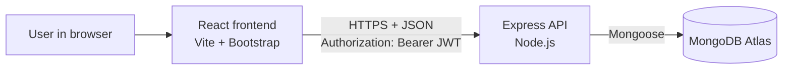
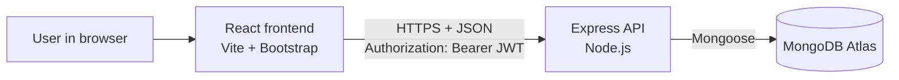

# 1. Technical Architecture

StaffSync is a three-tier MERN web application.

Diagram source (Mermaid)

| Tier | Technology | Job |
|------|-----------|-----|
| Presentation | React 18, React Router, Bootstrap 5, Axios | Pages, forms, tables. Shows only what the user's role allows. |
| Application | Node.js, Express | REST API: validates input, checks login and role, applies business rules. |
| Data | MongoDB (Atlas) via Mongoose | Stores users, leaves, attendance, announcements, trainings. |

## How a request travels

1. The user signs in. The API checks the password (bcrypt) and returns a **JWT** that contains the user's id, name and role.
2. React saves the token in `localStorage`. An Axios interceptor adds `Authorization: Bearer <token>` to every request.
3. Express runs the `protect` middleware (is the token valid?) and then `allow(...roles)` (is this role permitted?).
4. The controller runs the business rule, talks to MongoDB through a Mongoose model, and returns JSON.
5. React updates the screen.

## Security decisions

- Passwords are hashed with bcrypt and are never returned by the API (`select: false` on the field).
- Public sign-up always creates an **employee**. Only HR can create managers or other HR users.
- Roles are enforced on the **server**. The React route guards are only for convenience.
- Profile edits cannot change role, salary or department.
- Login only accepts strings, which blocks NoSQL-injection style payloads.
- CORS only allows the origins listed in `CLIENT_URL`.
- Secrets live in `.env` files that are excluded from Git.
