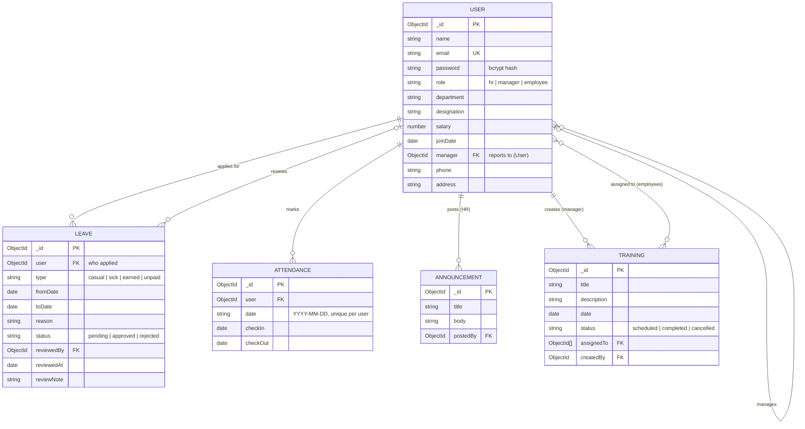

# 2. ER Diagram

Diagram source (Mermaid)

## Relationships in words

- One user can have many leave requests, many attendance rows (one per day), and can post many announcements (HR) or create many trainings (manager).
- A user can report to one manager (`manager` points to another user).
- A training is assigned to many employees, and an employee can have many trainings.
- `ATTENDANCE` has a unique index on (`user`, `date`), so nobody can check in twice on the same day.
- When HR deletes a user, their leaves and attendance are deleted and they are removed from trainings.
