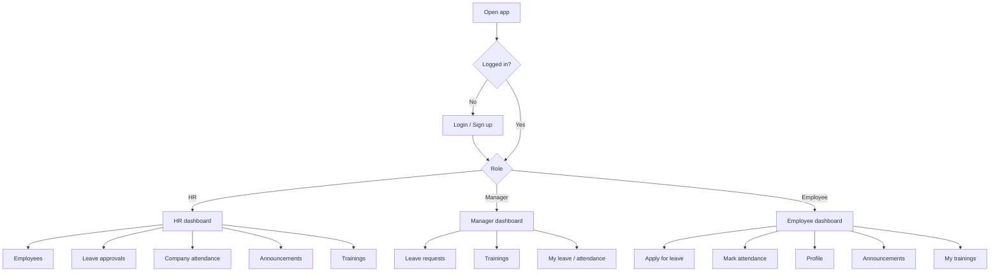
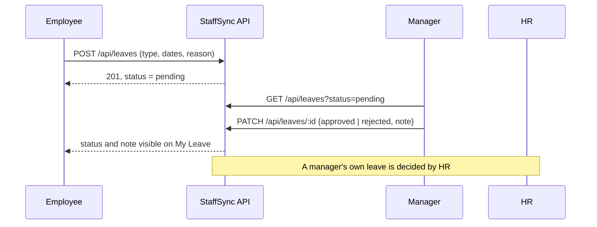

# 5. User Flow

## Overall flow

## Leave flow

## Attendance flow

1. Employee opens **Attendance** and clicks **Check in** (one per day).
2. At the end of the day they click **Check out**.
3. HR opens **Company attendance**, picks a date and sees everyone's times and hours.

## Training flow

1. Manager creates a training: title, date, description, selects employees.
2. Selected employees see it under **My trainings**.
3. Manager updates the status to completed or cancelled when it is done.
