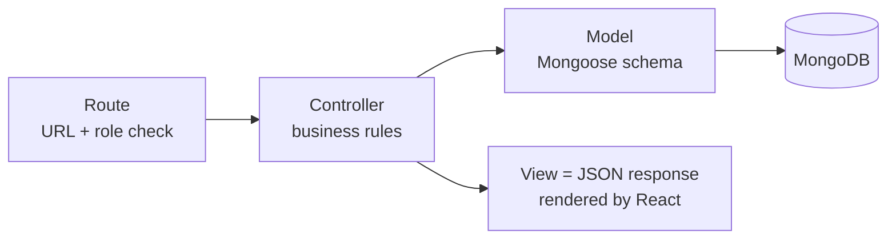

# 6. MVC Pattern

The backend follows **Model - View - Controller**, with routes in front.

Diagram source (Mermaid)

| Part | Where | Responsibility | Example |
|------|-------|----------------|---------|
| Model | `server/models/` | Shape and rules of the data | `Leave.js` defines types, statuses, and the `days` virtual |
| View | `client/src/` (React) | What the user sees. The API returns JSON and React is the view. | `pages/LeaveRequests.jsx` |
| Controller | `server/controllers/` | Reads the request, applies rules, calls models, sends the response | `leaveController.reviewLeave` |
| Routes | `server/routes/` | Maps URL + method to a controller, adds `protect` and `allow` | `routes/leaves.js` |
| Middleware | `server/middleware/` | Code that runs before controllers | `auth.js` |

## Example: approving a leave

1. `PATCH /api/leaves/:id` hits `routes/leaves.js`.
2. `protect` checks the token, `allow("hr","manager")` checks the role.
3. `leaveController.reviewLeave` checks the rules (pending only, not own leave, manager scope).
4. It updates the `Leave` model, which saves to MongoDB.
5. It returns JSON, and React re-renders the table.

## Why MVC

- Each file has one job, so bugs are easy to find.
- Business rules live in controllers and never in the UI, so they cannot be skipped.
- Adding a feature follows the same four steps: model, controller, route, page.
